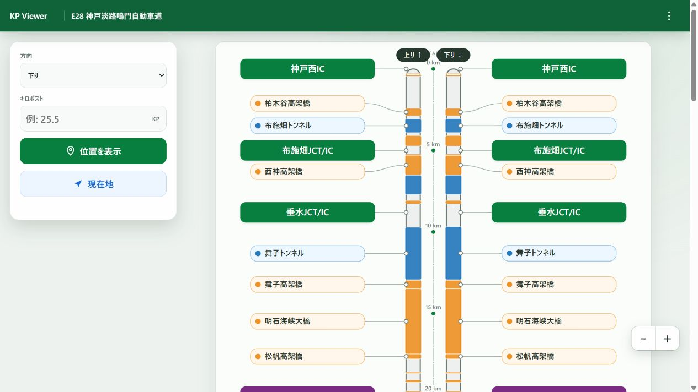
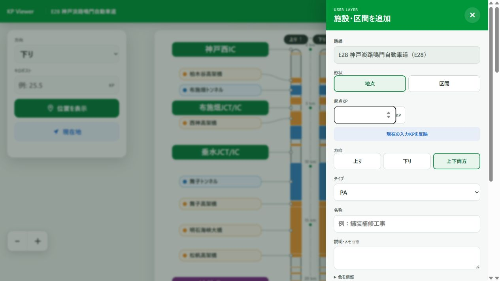
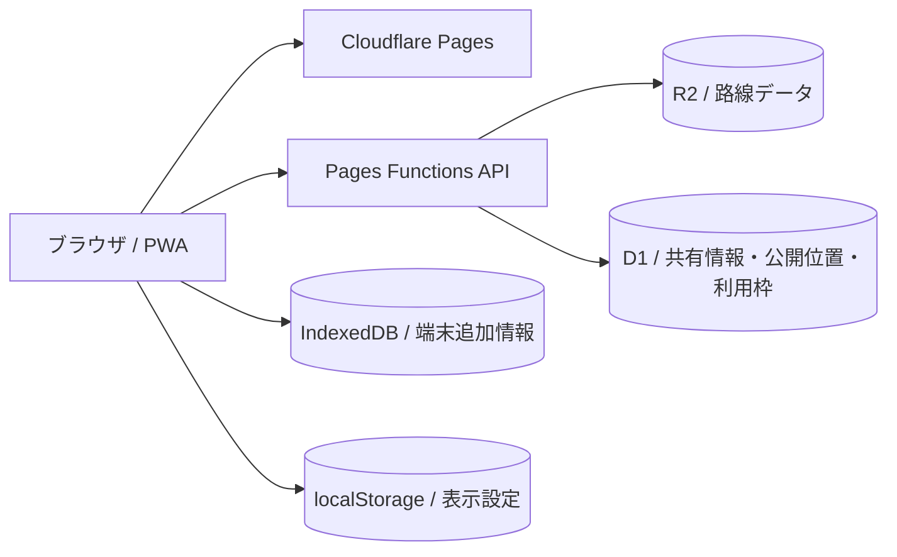

# Highway KP Viewer

高速道路のキロポスト（KP）を基準に、現在位置と周辺施設を確認するWebアプリです。縦長の路線図、GPSによるKP表示、地点・区間の追加、対応ICのランプ詳細を提供しています。現在はベータ版です。

[公開アプリ](https://highway-kp-viewer.pages.dev/) · [操作・技術資料](docs/README.md) · [変更履歴](docs/release-notes.md) · [稼働中アプリの版番号](https://highway-kp-viewer.pages.dev/app-version.json)

操作ガイドの確認対象：`2026.11.7-beta.10`。文書は[利用ガイド](docs/README.md#利用ガイド)と[開発・仕様](docs/README.md#開発仕様)に分けています。個々の画面の説明から、保存・APIの仕様へ順に読み進められます。



## 1. できること

| 用途 | 主な機能 |
| --- | --- |
| KPから場所を確認 | 路線・方向・KPを指定し、路線図と現地確認リンクを表示 |
| 周辺施設を把握 | IC・JCT・SA・PA、橋梁・トンネルをKPに沿って配置 |
| 現在地を確認 | GPS座標から収録路線・方向・KPを推定 |
| 移動に合わせて閲覧 | 専用の走行モードでKP・速度と周辺の路線図を表示 |
| 走行位置を公開・閲覧 | 任意で公開した車両を匿名番号・0.1KP単位で路線図へ表示。公開・閲覧とも初期オフ |
| 現場情報を追加 | 工事・事象・設備・メモを地点または区間として別レイヤーへ保存 |
| ファイルで持ち運ぶ | 追加データをJSON・CSVで読み込み、書き出し。写真は端末内に添付し、写真込みZIPで移動 |
| 管理区間に絞る | 全国・道路会社・支社・管理事務所等の入口と表示範囲 |
| 現地を確認 | Google Street Viewへのリンク、OSM地図・地理院写真のミニマップ |

道路ごとに、上り・下り、東行・西行、内回り・外回りの表示名へ対応します。複数の道路名・KP体系、不連続区間、未開通区間を持つ路線も扱います。収録内容や補正状況は路線によって異なります。

## 2. 基本操作

### 路線図を見る

路線一覧から対象路線を選び、方向とKPを入力して「表示」を押します。施設ラベルや本線上の区間を選ぶこともできます。収録範囲外や未開通区間では、その状態を案内します。

拡大・縮小ボタンは長押しに対応し、PCではShift＋ホイールも利用できます。通常ビューの拡大上限は10倍です。KP軸の目盛りは縮尺に応じて0.1・0.5・1・5・10KP間隔へ切り替わります。

右上メニューからテーマ、橋梁・トンネル・他者位置の表示、編集モード等を選べます。構造物ラベルのホバー／タップによる[諸元表示](docs/structure-details.md)は、構造物データがある全路線へ対応しています。OSM由来と判定した延長は表示しません。

### 走行モードを使う

メニューから開始すると、事前の測位待ちなしで専用画面へ進みます。本線上では路線・方向・KP・速度を表示し、周辺の施設や追加情報を確認できます。

本線外でも開始できます。その場合は開いていた路線を維持し、現在地KPは `--`、参考位置は灰色の横線で表示します。GPSが速度を返せば速度は表示します。路線図を手動で閲覧しても現在地の取得は続き、「現在地へ戻る」で追従へ戻れます。

GPSロスト時は通常30秒まで位置を推定します。対象トンネルでは固定速度による推定を出口まで継続し、出口で復帰を待ちます。推定は実測と区別して表示します。スマホ縦画面は長い路線名の文字サイズを調整した低いヘッダー、横画面は計器盤と路線図の2列を使用します。下部の状態は1行にまとめています。

操作、デモ、判定条件、限界は[走行モード仕様](docs/drive-mode.md)を参照してください。

### 走行位置を公開する・他の車両を見る

走行モードの「位置を公開」で確認に同意すると、本線上で確定した位置を通常の路線図へ🚗・ユーザー番号・0.1KP単位で公開します。初期は非公開で、開始時の公開ダイアログはありません。公開中は「位置公開を停止」、本線外で待機しているときは「位置公開待機中」です。

他者を見る場合は、通常の路線図の「他者の公開位置」をオンにします。閲覧も初期オフで、オンの画面だけが10秒ごとに取得します。自分の公開と他者の閲覧は独立しています。位置は最終更新から30秒で一覧から消えます。

公開先はこのサイトの閲覧者であり、限定グループの共有ではありません。公開範囲、保存・失効、通信回数とAPIは[位置公開・他車両表示](docs/live-locations.md)にまとめています。デモは🚙で区別します。機器専用の認証・名称対応は未実装です。

### 地点・区間を追加する

編集モードでKP・方向・種別・名称を入力し、「追加する」で保存します。既存項目は「編集」→「変更を保存」で更新し、「編集をやめる」で新規入力へ戻ります。



画像はパネル構成の参考です。現在のファイル操作欄は次の構成です。

```text
この路線の追加データ
[全削除]       [ファイル読込] [JSON ▼] [書き出し]
```

| 保存・ファイル操作 | 動作 |
| --- | --- |
| この端末のみ | IndexedDBへ保存。管理者キー不要 |
| 共有・全員に表示 | サーバーへ保存。追加・変更・削除に管理者キーが必要 |
| ファイル読込 | CSV・JSONを検証して端末へ保存。共有投稿にはならない |
| 書き出し | 現在の路線の追加データをJSONまたはCSVで保存 |
| 写真・ZIP | 全路線の端末保存の地点に写真を3枚まで添付。写真込みZIPでバックアップ・移動 |
| 全削除 | 件数を確認して削除。共有項目を含む場合は管理者キーが必要 |

JSONは属性を確認して保存する用途、CSVは表計算ソフトで編集する用途に向いています。同じIDを維持して読み込むと更新でき、IDを削除すると新規項目になります。

入力例・必須列・再読込・重複防止・削除範囲は[編集モードの操作とファイル形式](docs/user-annotations.md)にまとめています。

### 路線図を印刷・PDF保存する

路線ページのメニューから「印刷・PDF」を選び、開始・終了KPを指定します。表示中の縮尺と施設の表示設定を使い、本線・KP軸・施設・追加データを印刷します。フロート操作UIは含めません。

iPhone・iPadのホーム画面アプリでは、アプリ内プレビューを表示してから「印刷・PDF」で印刷を開始します。印刷の終了・キャンセル後は、上部の「路線図へ戻る」で元の画面へ戻れます。PC・Android・通常Safariでは従来どおり別画面を開き、自動で印刷を開始します。

### IC内部を確認する

対応するICの小さなランプボタンから詳細ページへ移動し、色分けしたランプを選択してStreet Viewを開けます。現在のベータ公開対象はE28の津名一宮ICです。

[ICランプページの操作と公開範囲](docs/ic-ramp-pages.md)

## 3. GPS不要のデモと入口

以下の走行モードデモは固定の表示確認用です。GPSを取得せず、位置検索APIを定期送信しません。路線情報等の読込には通信を使用します。通常デモで「位置を公開」に同意した場合は、実位置ではなくデモ位置を定期送信します。トンネルロストのデモは公開しません。

| 画面 | リンク |
| --- | --- |
| E28の通常路線図 | [開く](https://highway-kp-viewer.pages.dev/viewer?route=e28&portal=honshi) |
| E30の通常路線図 | [開く](https://highway-kp-viewer.pages.dev/viewer?route=e30&portal=honshi) |
| E28の走行モード・50KP | [開く](https://highway-kp-viewer.pages.dev/drive.html?route=e28&demo=1&demoKp=50) |
| E28のトンネル内GPSロスト・20秒 | [開く](https://highway-kp-viewer.pages.dev/drive.html?route=e28&demo=1&demoState=tunnel&demoKp=10&demoLost=20) |
| E28のトンネル出口・GPS復帰待ち | [開く](https://highway-kp-viewer.pages.dev/drive.html?route=e28&demo=1&demoState=tunnel&demoKp=10&demoLost=150) |
| 津名一宮ICランプ詳細 | [開く](https://highway-kp-viewer.pages.dev/prototypes/ic-ramps/?ic=tsuna-ichinomiya) |
| 追加データのCSV→JSON変換 | [開く](https://highway-kp-viewer.pages.dev/tools/annotation-converter/) |

編集モードは通常路線図の右上メニューから開いてください。「この端末のみ」の追加・ファイル読込には管理者キーを必要としません。

## 4. データの性質と公開範囲

路線形状の基礎にOpenStreetMapを使用し、KPを扱える形式へ加工しています。施設や構造物の位置・延長の出典、補正の密度は一律ではありません。道路管理、工事、規制、測量等の判断では道路管理者の最新資料を優先してください。

この公開リポジトリはソースと説明資料のスナップショットです。公開アプリとは別に更新しているため、すべての最新コード・デプロイ設定が常に含まれるわけではありません。文書に記した対象版を確認してください。

| 公開するもの | このリポジトリに含めないもの |
| --- | --- |
| 操作説明、API仕様、一般的な位置変換アルゴリズム | 路線別の高精度GeoJSON |
| 公開可能な画面・サーバー実装のスナップショット | 路線別のKP補正点・中間生成物 |
| 設定の構造とデータモデル | 内部の加工手順・路線別設定・認証キー |

路線ファイルを収録しないことと、APIの表示情報を秘匿することは別です。APIは施設・構造物・KP範囲など、表示に必要な路線情報を返します。高精度線形全体は返しません。

[OSM由来データの説明](docs/osm-derived-route-data.md) · [地図コンテンツ利用ガイド](docs/map-content-usage.md)

---

## 5. システム構成

以下は開発者向けの説明です。



| 層 | 構成 |
| --- | --- |
| 画面 | HTML・CSS・JavaScript、SVGによる路線図 |
| ミニマップ | Leaflet、OSM地図・地理院写真 |
| 位置API | Cloudflare Pages Functions |
| 高精度路線線形 | 非公開のCloudflare R2 |
| 共有追加データ・最新公開位置 | Cloudflare D1。公開位置は履歴テーブルではなく上書き |
| 端末追加データ | IndexedDB |
| テーマ・表示設定 | localStorage |
| 開発用サーバー | Node.js。Cloudflare本番の実行環境とは別 |

本番で常駐するNode.jsサーバーを起動する構成ではありません。Pages Functionsがリクエスト単位でAPIを実行します。位置共有はWebSocketやSSEではなく、10秒間隔の送信・ポーリングです。往復デモ車は開始時刻から位置を計算するため、常駐処理やデモ専用の定期リクエストはありません。

## 6. APIとデータモデル

```http
GET /api/route/e28
GET /api/position?route=e28&direction=down&kp=50
GET /api/nearest?lat=34.38&lon=134.84&heading=200&speed=25&accuracy=12
GET /api/live-locations?route=e28
```

`nearest` は `route` を指定するとその路線内、指定しなければ収録路線から候補を検索します。返却値は内部方向 `up/down` と路線別の表示名 `directionLabel` を区別します。速度入力はm/s、画面表示はkm/hです。

- [路線・KP検索API](docs/route-search-api.md)
- [KP・座標変換アルゴリズム](docs/kp-coordinate-algorithms.md)
- [データモデルと公開境界](docs/data-model.md)
- [追加情報の保存・競合検出・ファイル形式](docs/user-annotations.md)
- [位置公開API・保存先・通信回数](docs/live-locations.md#6-apiと実装)

## 7. 開発と確認

公開スナップショットの静的成果物は、収録された `package.json` の `npm run build` で生成します。ただし、路線データ・R2/D1・シークレットがないため、公開リポジトリだけで本番相当の位置APIを再現することはできません。

非公開の開発元では、Node.js 22以上を使用し、次の操作を用います。

```powershell
npm run dev
npm run verify:js
npm run build
```

開発サーバーの既定URLは `http://127.0.0.1:8787/`、ビルド先は `dist/` です。文書だけの確認で、路線データ全件の重い検証やブラウザ操作を行う必要はありません。画面・API・データ変更では対象機能に応じた検証を行います。

公開用コードと文書の更新は明示的に行い、非公開側のgit履歴を公開側へマージしません。公開コミットの著者・コミッターは `shoxtechlab` に統一して確認します。

## 8. 改善候補

以下は今後の候補であり、実装済み機能ではありません。

- 収録路線・管理区間・ICランプ詳細の拡充
- 車線数・設備属性を使った路線図の表示
- 特殊KP体系への対応拡張
- トンネルでの減速・渋滞とGPS復帰を考慮した推定改善
- ファイル読込前の差分確認・重複確認
- 追加データの選択書出・部分削除
- 共有情報の再取得方法と外部連携の整理
- 接続元別の短時間レート制限、位置投稿の参加認証、機器ごとの管理
- 公開位置のバックアップを含む保存・削除方針の継続的な整理

## 9. ライセンス

Copyright © 2026 shoxtechlab. All Rights Reserved.

許諾なく利用・複製・改変・再配布等を認めるオープンソースライセンスではありません。ソースの公開と利用許諾は別です。詳細は[LICENSE](LICENSE)を参照してください。第三者ソフトウェア・地図・データには、それぞれのライセンスが適用されます。
