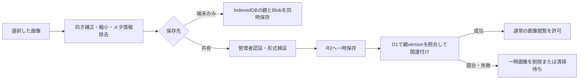

# 追加データへの画像添付：設計案と実装準備

更新日：2026年11月6日。`2026.11.6-beta.9`でE28へ試験導入し、`2026.11.6-beta.10`で**全路線の地点・この端末のみ**へ展開しました。写真選択・縮小・保存・閲覧・取り外し・画像込みZIP入出力に対応します。共有画像、D1・R2の追加は未実装です。以下は実装済みの端末保存と将来の共有設計を分けて説明します。

[編集モードの現行仕様](user-annotations.md) · [資料一覧](README.md)

## 1. 対象と利用方法

追加データの地点へ現地写真を添付し、路線図で選んだ地点から写真を閲覧できるようにします。最初は編集モードで追加した「地点」のみを対象とし、区間への添付や既存のIC・橋梁等への添付は後続対応とします。

画像はKP数値ではなく、追加データの`routeId`と`id`へ紐付けます。同じKPに複数設備があっても区別でき、名称・KP・方向を変更しても添付が外れません。

### 編集画面

名称・説明の下へ「写真（任意）」を配置します。

```text
名称
説明・メモ
写真（任意）                         1 / 3
[写真を選択]  [サムネイル・説明・取り外し]
表示期限・表示範囲
[追加する / 変更を保存]
```

初期案は「ファイルを選ぶ」です。スマホの選択画面で撮影・写真ライブラリを選べる場合もありますが、OSが決める挙動なので、特定の撮影操作を強制しません。

保存前の選択は一時状態とし、「編集をやめる」では添付変更も破棄します。再保存時は既存画像を維持し、利用者が明示的に取り外したものだけを削除対象にします。

### 路線図と閲覧画面

既存ラベルのKP移動を維持し、画像がある項目へ小さなカメラボタンを付けます。編集パネルの追加済み一覧には写真の件数を表示します。写真ボタンはKP選択と別の操作にし、画像閲覧だけでは位置を変更しません。印刷対象には写真閲覧ボタンを含めません。

写真はダイアログで表示します。読み込み中・失敗時・未保存画像がある場合を区別し、外側タップ、閉じるボタン、Escapeで閉じます。路線図の描画時には画像本体を一括取得しません。走行モードでは写真を自動的に開かない方針です。

## 2. 保存先と公開範囲

| 対象 | メタデータ | 画像本体 | 認証 |
| --- | --- | --- | --- |
| この端末のみ | 追加レコードの`images` | 同じIndexedDB内の専用ストアにBlob保存 | 不要。サーバーへ送らない |
| 共有・全員に表示（未実装案） | D1の追加レコードと画像管理テーブル | 添付専用のR2バケット | 追加・変更・削除は既存の管理者キー |

共有画像は、現在の「全員に表示」と同じく一般閲覧可能な情報とします。機密画像のアクセス制御を兼ねる設計にはしません。

R2は高精度路線データ用の`ROUTE_DATA`と分離し、画像専用の`ANNOTATION_IMAGES`バインディングを追加する案です。画像読取APIが路線GeoJSONや補正点を参照できる構成にしません。R2の公開URLや任意のオブジェクトキーをクライアントへ持たせず、画像IDを使う同一サイトのAPIから返します。

現行実装では、写真がある地点を区間・共有へ変更するには先に写真を取り外す必要があります。黙って写真を削除・アップロードしません。共有APIへ写真メタデータを直接送った場合も400で拒否し、写真情報を落として保存成功とはしません。将来共有対応するときは、転送完了前に元画像を削除しないことを要件とします。

## 3. 初期制限案

試験実装の制限値は次のとおりです。

| 項目 | 初期値案 |
| --- | --- |
| 1地点の画像数 | 最大3枚 |
| 選択する原画像 | 1枚20MiB以下 |
| 保存後の画像 | 1枚5MiB以下 |
| 保存後の解像度 | 縦横とも最大1,600px。縦横比維持・小さい画像は拡大しない |
| 保存形式 | PNGはPNG、JPEG・WebP・読取可能なHEICはJPEGへ再描画。ZIP読込はJPEG・PNG・WebP |
| 画像ごとの説明 | 120文字以内 |
| HEIC等 | ブラウザで読めれば再エンコード。非対応ならJPEG等への変換を案内 |

向きを正して再エンコードし、EXIFのGPS位置や撮影端末情報は保存対象にしません。処理後のサイズ・画像形式を再確認し、拡張子だけでは判断しません。SVG・HTML・GIFのアニメーションや外部画像URLは初期対応に含めません。

共有側でもサーバーで形式・サイズ・画像としての妥当性を検証することを実装要件とします。ブラウザのチェックだけでは受け入れません。Worker上の検証・再エンコード方法とCPU負荷は、本実装前に小さな画像で検証して確定します。今回、画像サービスや有料機能を有効にする操作は行っていません。

## 4. データ形式の準備

画像メタデータの定義は[image.schema.json](../design/annotation-images/image.schema.json)に置きます。実装は`js/annotationImageData.js`で同じ制限を検証します。

写真付きレコードは`schemaVersion: 2`と任意の`images`配列を持ちます。画像なしの従来データはそのまま扱います。1画像の定義は次のとおりです。

```json
{
  "id": "b7c43d21-0f24-47c5-901e-20591d2f0158",
  "mediaType": "image/jpeg",
  "byteLength": 180000,
  "width": 1600,
  "height": 1200,
  "caption": "設備の外観（説明用）",
  "createdAt": "2026-11-06T00:00:00Z"
}
```

画像の公開範囲は親レコードに従い、画像だけに別の公開設定を持たせません。メタデータには画像バイナリ、管理者キー、端末ファイルパス、R2キーを入れません。表示順は配列順で保持します。

読込は形式1・2に対応し、未知のバージョンは拒否します。写真付きJSONだけでは別端末へ写真を移せません。同じ端末に対応する画像本体がなければ全件の保存を中断し、ZIPを案内します。

## 5. 端末保存の準備方針

IndexedDBをバージョン2へ更新し、既存の`items`を維持して`images`ストアを追加しました。キーは画像ID、値は親レコードID・路線ID・Blobとし、親のインデックスを設けます。`js/annotationStore.js`を編集・走行モードから共用します。古いタブが更新を妨げる場合はタブを閉じる案内を出します。

既存の`items`ストアやレコードは削除しません。親レコードと画像の追加・削除を同じトランザクションで保存し、途中失敗で親だけ／画像だけ残らないようにします。容量不足時はフォームにエラーを表示し、元データを維持します。

IndexedDBを開く処理は編集モード以外にも走行モードで使用しています。バージョン番号とストア定義を共通化し、全入口でアップグレード・`versionchange`・`blocked`を扱うことが必要です。編集側だけをバージョン2へ上げる変更は避けます。

## 6. 共有保存のAPI案

以下は予約案です。現時点で利用できるエンドポイントではありません。

| API案 | 処理 |
| --- | --- |
| `POST /api/annotations/:id/images?route=…` | 管理者が画像を追加。multipartと親の期待versionを受ける |
| `GET /api/annotation-images/:imageId?route=…&annotation=…` | 有効な親に紐づく画像を返す |
| `DELETE /api/annotations/:id/images/:imageId?route=…` | 管理者が画像を取り外す。親の期待versionを照合 |

追加・削除は、既存の共有レコードと同じ楽観ロックを適用する案です。画像配列を更新すると親の`version`も増やし、古い編集画面からの更新は409で拒否します。



R2とD1は1つのトランザクションにはできません。画像管理テーブルに一時・有効・削除待ちを記録し、親への関連付けが成功したものだけを読取可能にします。失敗した一時画像と削除待ちは後から清掃します。実データのR2キーはサーバー側で生成し、利用者から任意のパスを指定させません。

親の削除・期限切れ・画像の取り外しでは、まず閲覧不可にしてから画像本体を清掃します。期限切れはAPIで非表示になってもR2から自動削除されるわけではないため、清掃用ジョブの設計・設定が必要です。管理者キーや期限を変えただけで画像URLのキャッシュに古い画像が残らないよう、初期実装の画像レスポンスは`Cache-Control: no-store`を基本とします。

## 7. CSV・JSONと画像の持ち運び

画像をCSVのセルやJSONへBase64として直接埋め込む方式は採用しません。ファイル肥大化・メモリ使用・共有権限との混同を避けるためです。

- CSV：既存の地点データの編集用。画像は同梱できない旨を表示して書き出す。
- JSON：メタデータを保存できるが、それだけでは別端末へ画像本体を移せない。
- 完全な持ち運び：全路線で選べるZIPに`annotations.json`と`images/<imageId>.<拡張子>`を同梱。

画像付きレコードをCSV・メタデータのみのJSONへ書き出す場合は、画像本体を含まないことを実行前に確認できるようにします。同じ端末の既存画像を、CSV再読込で意図せず消さない更新規則も必要です。

ZIPを読み込んでも保存先は「この端末のみ」です。このアプリが出力した無圧縮ZIPに限り、全体100MiB・最大500件を受け付けます。パス・CRC・画像数・形式・解像度・余分なファイル・画像欠損を検証し、画像と親をまとめて保存します。CSVで画像列を省略した更新は既存写真を維持し、JSONで明示的に`images: []`を指定した場合は取り外します。

## 8. 実装順と未実施事項

1. IndexedDBの共通化・後方互換・画像メタデータの読込検証を用意する。
2. 端末のみの画像選択・縮小・保存・表示・取り外しを実装する。
3. 画像付きデータの持ち運びと、既存CSV・JSONとの往復を確認する。
4. 共有画像用R2・D1管理テーブル・認証付き書込APIを追加する。
5. 競合、期限切れ、親削除、途中失敗時の清掃を確認して共有を有効化する。

既存レコードが消えないこと、画像なしデータが従来どおり使えること、全国版・管理事務所版で同じ添付を参照することを確認項目にします。iPhone写真の向き・HEIC非対応・容量不足も実機確認の対象です。

上記1〜3を全路線へ展開しました。4〜5の共有対応、クラウド側の設定変更、画像のサーバー送信は実施していません。iPhone実機のHEIC・縦横回転・容量不足は利用者による確認が必要です。

### 共有実装の有効化条件

既存の路線データ用R2バインディングを画像保存へ流用しません。以下を満たしてから共有UI・書込APIを有効化します。

- 画像専用R2とD1画像管理テーブルを用意し、ローカル環境でも同じAPI契約で検証する。
- 画像操作には既存の管理者キーと親レコードのversion照合を必須とする。閲覧は共有項目と同じ一般公開扱いとする。
- 親の期限・削除・公開状態を毎回照合し、有効な親を持たない画像を配信しない。
- MIME・画像ヘッダー・サイズ・解像度をサーバーでも検証する。既存の端末ZIPはそのまま共有投稿にしない。
- R2への保存後にD1更新が失敗する場合の清掃と、削除待ちの再試行を実装する。
- 画像用容量上限・書込回数上限・停止スイッチを用意する。既存の路線APIの日次制限だけで画像費用も制限できるとは扱わない。

これらの設定・検証が揃うまでは、写真の共有投稿を拒否する現在の保護を維持します。
