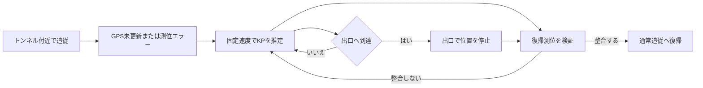

# 走行モード：操作と位置推定の仕様

[ドキュメント案内](README.md#利用ガイド) / 利用ガイド 01 / **走行モード**

確認対象：`2026.11.7-beta.10`。前半は操作、後半は判定条件・推定式・パラメータです。

走行モードは、路線図と現在の路線・方向・KP・速度を表示する専用画面です。位置情報を取得できない場合も、開いていた路線を参考表示し、スクロールして閲覧できます。

[通常の路線図](https://highway-kp-viewer.pages.dev/viewer?route=e28) · [GPS不要の表示デモ](https://highway-kp-viewer.pages.dev/drive.html?route=e28&demo=1&demoKp=50) · [資料一覧](README.md)

## 1. 開始と終了

1. 通常の路線ページで、必要に応じて方向とKPを選びます。
2. 右上のメニューから「走行モードを開始」を選びます。
3. 継続して位置情報を取得する旨の確認に同意すると、専用画面へ移ります。
4. ブラウザから位置情報の利用許可を求められた場合は、許可します。走行モードへの同意と、他者への位置公開は別の選択です。
5. 「走行終了」で位置情報の監視を止め、通常の路線ページへ戻ります。

開始前の測位待ちはありません。画面を開いた後に位置情報を取得し、収録路線から現在地を判定します。位置公開は初期オフで、開始直後に公開確認ダイアログは出ません。「位置を公開」を押した場合だけ同意を確認します。操作は停車中など安全な状態で行ってください。

## 2. 画面の読み方

| 表示 | 内容 |
| --- | --- |
| ヘッダー | 表示中の路線、位置公開操作、表示設定、終了ボタン |
| 方向 | 上り・下り、東行・西行、内回り・外回りなど路線別の呼称 |
| 大きなKP | 本線上と判定できた現在位置。複数KP体系では路線KPを表示 |
| 速度 | 端末が返した速度をkm/hへ換算。取得できない場合は `--` |
| 青い現在地マーカー | 本線上の現在位置、またはその短時間の推定位置 |
| 灰色の横線 | 現在地とは別の、選択位置・最寄り位置・閲覧位置 |
| 下部ステータス | GPS精度・道路距離、未更新・本線外等の状態と、位置公開の状態を1行表示 |

現在地は画面中央ではなく下寄りの基準位置へ配置し、進行方向の先を広く表示します。「閲覧位置」は幾何学的な画面中央を意味しません。

最新の文言・本線外表示・トンネル表示は、以下のデモURLと状態表を参照してください。実際の端末で縦横を切り替えると、画面の配置も確認できます。

## 3. 測位状態ごとの動作

| 状態 | 表示する路線 | 現在地KP | 位置表示 | 速度 |
| --- | --- | --- | --- | --- |
| 開始直後・測位待ち | 開いていた路線 | `--` | 灰色の「選択位置」 | 取得できれば表示 |
| 本線上の有効判定あり | 判定された路線 | 路線KP | 青い現在地 | 取得できれば表示 |
| 本線外 | 開いていた路線を維持 | `--` | 灰色の参考位置 | 取得できれば表示 |
| 位置情報の許可なし・非対応 | 開いていた路線 | `--` | 灰色の参考位置 | 通常は `--` |
| 一般区間でGPS未更新 | 最後に判定された路線 | 上限30秒の推定値 | 推定した現在地 | 最後に取得した値 |
| 対象トンネル内でGPS未更新 | 最後に判定された路線 | 出口までの推定値 | 推定した現在地 | 推定開始時に固定した値 |

### 本線外で表示する位置

本線外と判定された場合は、現在地KPを表示しないことと、路線図を引き続き閲覧できることを案内します。最寄り候補が別路線でも、その路線へ切り替えません。下部の表示は「本線外」です。

- 最寄り候補が表示中の路線と一致：その候補位置を灰色の「最寄り位置」として表示します。
- 最寄り候補が別路線：現在の路線の選択位置などを維持します。別路線のKPを流用しません。
- 手動スクロール中：灰色の横線に「閲覧位置」とそのKPを表示します。

これらのKPは閲覧の基準です。上部の現在地KPは、本線外では常に `--` です。本線上の有効な判定が後から得られれば、現在地追従へ切り替わります。

## 4. 路線図をスクロールする

PCではドラッグまたはホイール、タッチ端末ではドラッグで周辺を閲覧できます。スクロール中も位置情報の取得と現在地KPの更新は続きますが、画面の自動追従は止まります。

- 本線上：「現在地へ戻る」で追従を再開します。現在地が画面外にある場合は方向と距離を案内します。
- 参考表示：「選択位置へ戻る」または「最寄り位置へ戻る」で参考位置へ戻ります。

通常ビューの拡大・縮小操作とは独立した画面です。

## 5. 表示設定と画面サイズ

「表示設定」で、橋梁、トンネル、事象・事故、工事・規制、その他の追加情報を切り替えられます。IC・JCT・SA・PAは常時表示します。

設定は走行モード専用で、同一サイト・同一ブラウザの `localStorage` に全路線共通で保存します。通常ビューの表示設定をそのまま引き継ぐ方式ではありません。

追加情報は端末のIndexedDBと共有APIから読み込みます。現状は路線データ読込時に取得するため、他端末からの共有変更がリアルタイム配信されるわけではありません。

スマートフォンの横画面では、幅1,000px以下かつ高さ500px以下を対象に2列へ切り替えます。左側に数値・操作・状態、右側に路線図をまとめます。縦画面と通常のPC画面は上下配置です。

### スマートフォン縦画面のヘッダー

路線名は文字数だけでなく実測幅に応じて18〜10pxで調整します。右側の表示設定・走行終了を優先し、左側には固定幅の位置公開ボタンを置きます。ヘッダー本体は約74px（iPhoneの上部安全領域を除く）です。

```text
┌──────────────────────────────────┐
│ E28 路線名（幅に合わせて縮小）│ 表示 │ 走行 │
│ [位置を公開]                 │ 設定 │ 終了 │
└──────────────────────────────────┘
```

右の2ボタンは各76px、位置公開ボタンは幅94px・高さ36pxです。回転や路線切替時に路線名を再計算します。公開中は「位置公開を停止」、本線外で待機中は「位置公開待機中」です。配色と公開条件は[位置公開ガイド](live-locations.md#1-自分の位置を公開する)を参照してください。

## 6. GPSロストとトンネル通過

### 一般区間

GPS位置を最後に受信した時刻と、APIが最後にKPを判定した時刻を別々に管理します。

| GPS未更新時間 | 表示 |
| --- | --- |
| 10秒未満 | 通常表示。条件が揃えば速度による短時間推定 |
| 10秒以上 | KP・速度を灰色にし、未更新秒数を表示 |
| 30秒以上 | 位置の推定をそれ以上進めず、GPS信号待ちを表示 |

推定には速度1m/s以上と、取得済みであれば道路方位との差60度以内を必要とします。速度を取得できない場合などは移動推定を行いません。

### 登録済みトンネル

最後の判定位置がトンネル内、または進行方向の入口100m手前以内にあり、速度・方位の条件を満たす場合はトンネル用の推定へ切り替えます。トンネルラベルを非表示にしていても、判定には利用します。

1. GPS未更新10秒、または追従中の一時的な測位エラーを契機に推定を開始します。
2. 最後のAPI判定位置を基準に、推定開始時の取得済み速度を固定して進めます。
3. 30秒を超えても継続しますが、上下線別の出口KPを越えません。
4. KP・速度を灰色にし、下部は「トンネル内 · 推定中」とします。上部の速度単位は `km/h` のままで、推定開始時に固定した速度を表示します。
5. 出口に達してGPSが復帰しない場合は、「出口付近 · GPS待ち」と表示して推定位置を止めます。



渋滞、減速、停車は固定速度の推定に反映できません。出口で止めるのは過剰な前進を抑えるためであり、実際の出口到達を保証するものではありません。

復帰には、同一路線・同方向、GPS精度100m以下、道路距離が `max(100m, GPS精度×2)` 以下、推定KPとの差が `max(200m, GPS精度×2)` 以下であることを必要とします。整合しない測位は採用せず監視を続けます。

## 7. GPSを使わずに表示を確認する

以下はE28の固定デモです。GPS取得や位置検索APIへの継続送信は行いません。路線情報と追加情報の読込には通信を使用します。通常デモは、明示的に「位置を公開」に同意した場合だけ、仮想位置を他の路線図へ送信します。ロスト推定デモは公開しません。

| デモ | URL |
| --- | --- |
| 通常表示・50KP | [開く](https://highway-kp-viewer.pages.dev/drive.html?route=e28&demo=1&demoKp=50) |
| 舞子トンネル付近・ロスト20秒 | [開く](https://highway-kp-viewer.pages.dev/drive.html?route=e28&demo=1&demoState=tunnel&demoKp=10&demoLost=20) |
| 出口でGPS復帰待ち | [開く](https://highway-kp-viewer.pages.dev/drive.html?route=e28&demo=1&demoState=tunnel&demoKp=10&demoLost=150) |

`demo=1` で固定デモを有効にし、`demoKp` に最後の判定KPを指定します。`demoState=tunnel` の場合は登録済みトンネル内のKPを指定してください。`demoLost` は10～3,600秒に制限され、未指定時は20秒です。通常デモは画面例であり、連続移動を再生する機能ではありません。

## 8. 位置判定と補間の実装

Geolocation APIは緯度・経度・精度・速度・方位を通知します。通知頻度は端末・OS・ブラウザが決めるため、「GPSを5秒ごとに取得する」という仕様ではありません。アプリは位置検索APIの送信間隔を最短5秒へ制限し、画面の推定値を500ms間隔で更新します。

起動時は最初の有効判定を暫定表示し、次の有効判定で路線・方向を確認または補正します。その後、別路線への切替は同じ候補の連続2回を必要とします。追従中の本線外判定も連続2回で確定します。起動時の本線外表示には、この追従中の待ち回数を適用しません。

```text
方向符号 = 下りなら +1、上りなら -1
KP増分 = 方向符号 × 速度[m/s] × 経過時間[ms] / 1,000,000
路線KP増分 = KP増分 × 区間の kp_direction
```

通常補間の中核は次の式です。`elapsedMs` はAPI最終判定からの経過時間を30秒で制限します。

```js
const directionSign = lastMatch.direction === "down" ? 1 : -1;
const routeDeltaKm = directionSign * speed * elapsedMs / 1_000_000;
const section = currentRoute.road.sections?.find(item => item.id === lastMatch.section);
const localDeltaKm = routeDeltaKm * (section?.kp_direction || 1);
```

トンネル用の推定移動量は、出口までの距離を上限とします。

```js
const distance = Math.min(
    Math.max(0, (state.exit - origin) * state.sign),
    state.speed * Math.max(0, now - state.startedAt) / 1_000_000
);
```

### パラメータ一覧

| 項目 | 値 |
| --- | --- |
| 位置検索APIの最小送信間隔 | 5,000ms |
| 画面の推定更新間隔 | 500ms |
| GPS未更新の警告開始 | 10,000ms |
| 通常区間の補間時間上限 | 30,000ms（API最終判定から） |
| 測位タイムアウト／キャッシュ許容 | 15,000ms／3,000ms |
| 通常の道路近傍許容距離 | `max(300m, GPS精度×2)` |
| 初回暫定表示／次回補正 | 最初の1回／次の有効判定 |
| 通常の路線切替／追従中の本線外確定 | 連続2回／連続2回 |
| 速度補間の最低速度 | 1m/s |
| トンネル入口の判定余裕 | 100m |
| トンネル復帰測位の精度上限 | 100m |
| 基本縮尺 | 120px/km |

APIリクエストは継続利用1時間あたり最大約720回が目安です。路線・追加情報の読込は別途発生し、通信状況や実行待ちで位置検索回数は減ります。料金やサービス上限を示す数値ではありません。

現行の主要実装は `drive.html`、`js/drive.js`、`css/drive.css` です。APIの射影・補間は[KP・座標変換アルゴリズム](kp-coordinate-algorithms.md)を参照してください。

## 9. 下部の状態表示

下部は「走行状態｜公開状態」の1行です。路線名・トンネル名・速度など、画面の他の場所で分かる情報は繰り返しません。公開状態は「非公開／公開確認中／位置公開待機／公開中／公開エラー」です。

| 状況 | 走行状態の例 |
| --- | --- |
| 起動・路線検索 | 測位中／路線検索中 |
| 初回判定・本線位置の再確認 | 位置確認中／位置確認中 · 道路350m |
| 路線の候補確認・切替確認 | 路線確認中 1/2／路線切替を確認中 1/2 |
| 通常・速度補間 | GPS ±8m · 道路4m／推定 · GPS ±8m · 道路4m |
| GPS未更新・推定停止 | GPS未更新20秒 · 推定中／GPS未更新30秒 · 推定停止 |
| トンネル内・出口 | トンネル内 · 推定中／出口付近 · GPS待ち |
| 本線外 | 本線外 |
| 測位エラー | 位置情報が未許可／測位できません／測位タイムアウト／測位エラー |
| API照合エラー | 路線照合エラー · 再試行中 |
| 非対応・停止 | 位置情報に非対応／走行モード停止／走行終了 |
| 通常デモ・GPSロストデモ | デモ · GPS ±8m · 道路4m／デモ · GPS未更新20秒 |

公開状態は省略せず保持します。大きな文字設定・異常に長い数値などで収まらない場合は走行状態の末尾を省略し、折り返しによる高さの変動を防ぎます。API等の任意長の停止理由はフッターに詰め込まず、別の通知へ表示します。

## 10. 現時点の制約と改善候補

- 測位の精度や更新頻度は端末に依存します。速度・方位が得られない場合もあります。
- 初回の暫定判定は上下線や並行道路を誤る場合があり、次の有効判定で補正します。
- バックグラウンドや画面消灯時の継続測位は保証しません。
- トンネル推定は固定速度であり、渋滞・減速に対応していません。
- 道路近傍判定は参考推定であり、本線上にいることの証明ではありません。

今後の候補は、復帰時の位置変化の抑制、停車・減速を考慮した推定、共有情報の再取得方法の改善です。これらは現時点の実装済み機能とは区別します。

---

[ドキュメント案内](README.md#利用ガイド) · 次：[位置公開・他車両表示](live-locations.md) · 技術：[KP・座標変換](kp-coordinate-algorithms.md)
