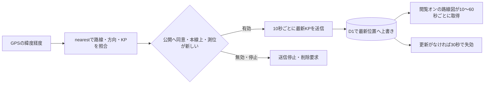

# 位置公開・他車両表示

[ドキュメント案内](README.md#利用ガイド) / 利用ガイド 02 / **位置公開・他車両表示**

確認対象：`2026.11.7-beta.10`。使い方を前半、保存・通信・APIの仕様を後半にまとめています。

走行モードから位置を公開し、他の利用者の通常路線図へ車両・ユーザー番号・KPを表示できます。**自分の公開と、他者位置の閲覧は別々の設定で、どちらも初期オフ**です。公開は限定メンバー向けではなく、このサイトの閲覧者が確認できる方式です。

## 1. 自分の位置を公開する

1. 通常の路線ページから[走行モード](drive-mode.md)へ入ります。開始時は非公開です。
2. 上部の「位置を公開」を押します。この操作をしたときだけ確認ダイアログが開きます。
3. 公開に同意すると、本線上で有効な位置が確認できた場合に送信を開始します。
4. 「位置公開を停止」でオフにできます。次回の起動へ同意は引き継ぎません。

| 状態 | ボタンと表示 |
| --- | --- |
| オフ | 「位置を公開」。下部は「非公開」 |
| 本線外で待機 | 「位置公開待機中」。白背景・赤枠・赤文字。押すと公開オフ |
| 公開中 | 「位置公開を停止」。赤背景・白文字。下部は「公開中」 |
| その他の待機・エラー | 下部に「位置公開待機」「公開エラー」等を表示。公開設定をオフにできる |

本線外、起動直後の暫定判定、路線切替の確認中、GPSロスト、トンネル内の推定では公開しません。最後に照合した測位が10秒を超えた場合、GPS精度・道路距離が100mを超える場合も待機します。通常の走行画面の道路近傍判定とは別の条件です。

ページが非表示になると公開を一時停止し、戻った後に新しい有効位置があれば再開します。走行終了・ページ終了後はオフです。ブラウザやOSがバックグラウンドでGPS・通信を続けることは保証しません。

## 2. 他の車両を路線図で見る

通常の路線図の右上メニューで「他者の公開位置」をオンにします。初期値はオフで、手動の選択を同じブラウザに保存します。オフの間は他者位置を取得しません。画面が非表示の間も定期取得を止めます。

オンにした直後と画面・操作への復帰時に取得します。操作中は他車ありで10秒、0台なら30秒、0台が3回続けば60秒間隔です。表示したまま別ウィンドウを操作している間は30秒間隔です。別タブ・最小化など非表示中は停止します。エラー時は最大60秒へ延長し、日次上限の429応答はリセット時刻まで待機します（オン・オフでも待機は解除しません）。

| 車両 | 表示 |
| --- | --- |
| 実GPSからの公開 | 🚗・「ユーザー001」等・0.1KP単位のKP |
| デモURLからの公開 | 🚙・「デモ・ユーザーNNN」・仮想KP |
| 管理者が動かす架空デモ車 | 🚙・「デモ車（80km/h）」等・仮想KP |

車両は方向ごとの本線上に配置し、施設・ランプリンク等より前面に表示します。複数のKP体系を持つ路線では、表示値は路線内KP、描画位置は内部通算KPです。

全国版・本四版・事務所版は、同じ路線の公開位置を参照します。事務所等の表示範囲外は表示せず、印刷には含めません。走行モード自体へ他車両を重ねる機能ではありません。

## 3. 止めた後の表示と保存範囲

公開停止・本線外・GPSロスト時には送信を止め、公開レコードの削除を要求します。通信が切れて削除できなくても、**最終受信から30秒**で通常の一覧から消えます。閲覧側は取得間隔と別に期限切れを判定します。30秒以上の取得間隔では車両表示が一時的に消える場合がありますが、古い位置の有効期限は延長しません。

保存するのは匿名番号、路線、方向、0.1KP単位の位置、時刻、実／デモの区別と、認証用トークンのハッシュです。アプリの位置テーブルに緯度経度・速度・IPアドレスは保存せず、最新位置を上書きします。

ただし、履歴テーブルを作らないことと、復元可能な過去データが一切存在しないことは別です。D1の復旧機構やホスティング基盤のログまで否定するものではありません。30秒は公開一覧の失効時間であり、バックアップを含む完全消去の期限ではありません。失効行は次の新規公開時に物理削除します。

公開位置を第三者が記録することは防げません。番号は再公開で変わりますが、本人確認や位置の真偽を保証する機能ではありません。安全確認・配車判断等の唯一の根拠にしないでください。

## 4. デモを試す

[E28・津名一宮付近の固定デモ](https://highway-kp-viewer.pages.dev/drive.html?route=e28&demo=1&demoKp=44.4)では、GPSを取得せず画面を確認できます。「位置を公開」に同意した場合だけ、その仮想位置をデモとして送ります。画面を閉じれば継続しません。`demoState=tunnel`のGPSロスト推定デモは公開対象外です。

これとは別に、管理者が設定したE28・E30・E76の往復デモ車があります。出発KP・方向・速度・開始時刻から位置を算出し、端点で折り返します。開始から1時間で自動停止します。位置履歴・定期DB書込・外部からの定期送信はなく、誰も閲覧していなければデモ車のためのAPI呼出は発生しません。

固定デモ、往復デモ、実利用者の公開は区別して表示します。デモ車の操作機能は管理者認証を必要とし、この利用ガイドでは操作入口を案内しません。

## 5. 通信回数と制限

| 処理 | 間隔・目安 |
| --- | --- |
| 自分の公開位置を送信 | 約10秒。約360回／時 |
| 他者位置を取得 | 操作中・他車あり10秒（約360回／時）。非アクティブ表示中30秒（約120回／時） |
| 走行モードの路線・KP判定 | 最短5秒。最大約720回／時。公開のオン／オフとは独立 |
| 車がいない路線の閲覧 | 30秒、0台が3回続けば60秒（約60回／時）。オフ・非表示なら定期取得なし |
| サーバーの往復デモ計算 | 一覧取得時だけ。計算専用の定期リクエストはない |

公開者1人が走行画面を使う場合、路線判定と公開更新で最大約1,080回／時が目安です。路線読込・状態確認・停止要求は別であり、実際の回数は端末・通信状態等で変わります。

コード上の標準値は、同時公開200セッション、位置作成・更新20,000回／UTC日です。KP検索・路線取得の50,000回／UTC日とは別に、位置共有API（閲覧・状態確認・作成・更新）へ50,000回／UTC日の独立枠を設けています。環境変数で変更できます。削除要求はどちらの上限にかかわらず受け付けますが、基盤自体の障害まで回避する保証ではありません。日付の切替は日本時間午前9時です。

これらはアプリの利用枠であり、Cloudflareの料金上限ではありません。拒否応答にもFunctionsやD1の処理が発生します。短時間・接続元別の制限や参加認証まで備えた仕組みではないため、大量アクセスによる枠消費、架空位置の投稿、収集を完全には防げません。

## 6. APIと実装

ここからは開発者向けです。APIの基底URLは `https://highway-kp-viewer.pages.dev/api`。位置変換APIとは異なり、位置公開APIは**緯度経度ではなく照合済みKPを受け取ります**。



| メソッド・パス | 用途 | 認証 |
| --- | --- | --- |
| `GET /api/live-locations?status=1` | 有効状態 | 不要 |
| `GET /api/live-locations?route=e28` | 有効な公開位置一覧 | 不要 |
| `POST /api/live-locations` | 公開開始。トークンを1度返す | 参加キーは不要 |
| `PUT /api/live-locations` | 自分の最新位置を更新 | Bearerセッショントークン |
| `DELETE /api/live-locations` | 自分の公開を停止 | Bearerセッショントークン |

送信例は説明用の架空位置です。`measuredAt`は送信時刻ではなく照合に用いた測位時刻をUnixミリ秒で設定します。

```json
{
  "routeId": "e28",
  "direction": "down",
  "routeKp": 44.4,
  "kp": 44.4,
  "kpSystemId": "route",
  "measuredAt": 1793972400000,
  "demo": false
}
```

| フィールド | 意味 |
| --- | --- |
| `routeId` | 収録済みの路線ID |
| `direction` | `up`／`down`。表示名とは区別 |
| `routeKp`／`kp` | 内部描画KP／路線内KP。どちらも保存時に0.1へ丸める |
| `kpSystemId` | 路線内のKP体系。単一路線は通常`route` |
| `measuredAt` | 測位時刻。サーバーでは15秒以内、未来は最大5秒まで許容 |
| `demo` | 仮想位置の場合`true`。実GPSであることを証明する属性ではない |

POST成功時は `id,label,demo,routeId,direction,routeKp,kp,kpSystemId,measuredAt,expiresAt,token`を同じ階層に返します。GET一覧の`positions`とPUT結果にはトークンを含めません。トークンは32バイトの乱数から生成し、サーバーへはSHA-256で保存、Web画面ではメモリだけに保持します。

| 主なエラー | 意味 |
| --- | --- |
| 400／415 | 値・形式・測位時刻・収録路線・JSON指定が不正 |
| 401 | 自分の公開を更新・削除するトークンが不正 |
| 403 | 異なるOriginからの書込 |
| 404 | セッション失効・削除済み |
| 409 | 現在の保存値より古い測位 |
| 413 | 本文が2,048バイトを超える |
| 429 | 最短9秒の更新間隔、人数、日次枠などの制限 |
| 503 | 機能・保存先の設定が無効、または共通停止中 |

書込は同一オリジンを基本としますが、Origin検証は機器・スクリプトの認証を代替しません。全レスポンスは`no-store`。削除済みのトークンを更新して公開を復活させない設計です。

## 7. 保存先・設定・ローカル確認

| 保存先 | 役割 |
| --- | --- |
| D1 `live_locations` | 最新位置、時刻、トークンのハッシュ、デモ区別 |
| D1 `live_location_usage`／`live_api_daily_usage` | 位置投稿と位置共有API全体の日次利用量。KP検索の`api_daily_usage`とは独立。個別車両の移動履歴ではない |
| D1 `live_demo_settings` | 管理者が動かす架空デモ車の開始設定と実効期限 |
| ブラウザメモリ | 自分の公開セッショントークンと公開意思 |
| localStorage | 他者位置を表示するかどうか。自分の公開同意は保存しない |

既存の共有編集・利用枠のD1へ、`0003_live_locations.sql`〜`0006_live_api_daily_usage.sql`を順に適用します。新規環境は既存の`0001`・`0002`も必要です。バインディングは`ANNOTATIONS_DB`と`ROUTE_DATA`です。段階デプロイ時は、位置共有の独立枠テーブルだけが未作成なら初回要求で`CREATE TABLE IF NOT EXISTS`により初期化します。他のDBエラーでは処理を拒否します。

```text
LIVE_LOCATIONS_ENABLED=true       # 未設定またはfalseで無効
LIVE_LOCATIONS_DAILY_WRITES=20000  # 位置作成・更新の合計
API_DAILY_LIMIT=50000             # KP検索・路線取得の枠
LIVE_LOCATIONS_DAILY_REQUESTS=50000 # 位置共有APIの独立枠
API_ENABLED=false                # 共通の緊急停止。通常運用ではtrue
```

設定変更が実行中のデプロイへ反映される手順はホスティング側に従います。`LIVE_LOCATIONS_ENABLED=false`で位置公開だけを無効にしても、通常の路線図・走行モードのKP照合は継続できます。一方、`API_ENABLED=false`はKP変換・路線読込も対象にする共通停止です。

`npm run dev`はメモリ保存を使い、再起動で公開位置とデモ設定が消えます。HTTPS等の安全な接続でスマホGPSを利用してください。管理者キーや実測位置をテストコード・説明資料へ貼り付けません。

主な実装：`js/liveLocations.js`、`js/drive.js`、`js/main.js`、`server/live-location-service.js`、`server/live-location-handler.js`、`server/live-location-demo.js`、`server/live-demo-settings.js`。

機器から送信する場合は、GPS・照合結果の鮮度と本線外判定を機器側でも確認する必要があります。恒久的な機器認証・機器名の割当は未実装です。

---

前：[走行モード](drive-mode.md) · [ドキュメント案内](README.md#利用ガイド) · 次：[編集モード](user-annotations.md)
