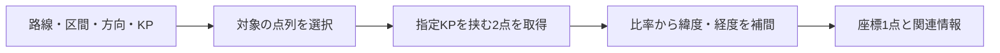

# 路線・KP検索API

[ドキュメント案内](README.md#開発仕様) / 開発・仕様 01 / **路線・KP検索API**

確認対象：`2026.11.7-beta.10`。公開環境の基底URLは `https://highway-kp-viewer.pages.dev/api` です。

画面の利用方法は[README](../README.md)、計算方法は[KP・座標変換アルゴリズム](kp-coordinate-algorithms.md)を参照してください。この文書は路線情報と位置変換の読取APIを説明します。追加地点の保存APIは[編集モード](user-annotations.md#7-データとapiの構成)、最新位置の公開APIは[位置公開](live-locations.md#6-apiと実装)へ分けています。

## 1. 共通仕様

- レスポンスはJSONです。エラーはHTTPステータスと `{ "error": "…" }` で返します。
- 緯度・経度はWGS84の度、道路距離・GPS精度はm、速度入力はm/sです。
- 方向の内部値は `up` / `down`、表示名は `directionLabel` です。
- 路線IDは `e28`、`e30`、`c3` などの識別子です。E始まりに限定されません。
- 最寄り候補が返ることと、利用者が本線上にいることは別です。道路距離と精度を利用側で評価します。
- 公開APIの可用性・利用上限・料金を保証する資料ではありません。

## 2. 路線の表示情報

```http
GET /api/route/e28
```

路線の表示情報 `road`、座標収録範囲 `coordinateCoverage`、複合路線では区間別範囲 `sectionCoverage` を返します。施設・橋梁・トンネル等のKP情報は表示用データとして返ります。路線全体の高精度GeoJSONを返すAPIではありません。

## 3. KPから座標を求める

```http
GET /api/position?route=e28&direction=down&kp=50
```

| 入力 | 必須 | 内容 |
| --- | --- | --- |
| `route` | 必須 | 路線ID |
| `direction` | 必須 | `up` または `down` |
| `kp` | 必須 | 0以上のKP数値 |
| `section` | 任意 | 複合路線の区間ID。指定時のKPはその区間の路線KP |

複合路線で `section` を指定しない場合、入力KPは内部の通算軸に従います。画面の路線名プルダウンに表示するKPと無条件に同じとは限りません。独自クライアントでは区間IDを明示してください。

返却には `route`、`section`、`direction`、`directionLabel`、`kp`、`localKp`、`routeKp`、`lat`、`lon`、`heading` 等を含みます。`localKp` は現地の路線KP、`routeKp` は内部表示軸の位置です。

収録範囲外のKPはHTTP 422です。負のKPや不正な入力はHTTP 400です。微小な浮動小数点誤差の端点処理と、実際の収録範囲を越える外挿は区別します。



## 4. 座標から路線・方向・KPを求める

路線を限定する場合：

```http
GET /api/nearest?route=e28&lat=34.729&lon=135.084
```

全収録路線を候補にする場合：

```http
GET /api/nearest?lat=34.729&lon=135.084&heading=180&speed=20&accuracy=12
```

座標はAPI入力例です。路線上の特定KPや実測結果を保証する例ではありません。

| 入力 | 必須 | 内容 |
| --- | --- | --- |
| `lat`, `lon` | 必須 | 緯度・経度 |
| `route` | 任意 | 検索を指定路線へ限定。省略時は全収録路線 |
| `heading` | 任意 | 進行方位。北0度、東90度、0以上360未満 |
| `speed` | 任意 | 速度。Geolocation APIと同じm/s |
| `accuracy` | 任意 | GPS精度、m |
| `preferredRoute` | 任意 | 直前の路線等の優先候補。検索路線の固定ではない |
| `preferredDirection` | 任意 | 優先方向 `up` / `down` |
| `sections` | 任意 | 対象区間IDのカンマ区切り |

主な返却値：

| フィールド | 意味 |
| --- | --- |
| `route`, `routeName`, `section` | 選択された路線と区間 |
| `direction`, `directionLabel` | 内部方向と、路線固有の方向表示名 |
| `kp`, `localKp`, `routeKp` | KPと内部軸上の位置。画面用途では路線KPを区別 |
| `distanceM` | 入力地点から採用線形への距離 |
| `snappedLat`, `snappedLon` | 採用線形上の射影位置 |
| `roadHeading`, `headingDifference` | 道路の進行方位と入力方位との差。条件により省略 |
| `directionMethod`, `routeMethod` | 方向・路線の判定方法 |
| `ambiguous` | 判定が同等となる候補等の曖昧性 |
| `alternatives` | 代替候補。全路線探索では他路線候補と距離差等 |

返却フィールドの有無は単一路線・複合路線・探索方法で異なります。`directionLabel` は上り・下りに加え、東行・西行、内回り・外回り等になります。表示名から内部方向を逆算せず、`direction` を処理に使用してください。

近距離候補の方向判定では、取得できる速度・方位も使用します。停止中や低速時の方位は不安定なため、位置距離を基本に判定します。代替候補の件数・形は検索方法で異なり、常に同じ形式・件数が揃う前提にしないでください。

## 5. 画面側での利用

走行モードは `route` を固定せず位置検索を行い、判定結果に道路距離の条件を適用します。本線外の場合は路線図を参考表示し、現在地KPは `--` にします。APIの最寄り値を、そのまま実際の走行位置として表示しません。

GPS更新間のKP推定はブラウザ側の走行モードで行います。APIの「線形上への射影・点間補間」と、画面の「速度×時間による移動推定」は別の処理です。

キャッシュ、使用回数の制限、認証を必要とする別用途の一括変換等は、各実行環境の設定・入口に従います。ここに示す読取APIの説明から、一括APIの認証条件を推測しないでください。

## 6. APIの使い分けと利用枠

| 目的 | API | 詳細資料 |
| --- | --- | --- |
| KPと座標の相互変換 | `position`／`nearest` | 本書 |
| 工事・設備などの保存 | `annotations` | [編集モード](user-annotations.md#7-データとapiの構成) |
| 車両の最新KPの公開・取得 | `live-locations` | [位置公開](live-locations.md#6-apiと実装) |
| 管理者による一括変換 | `batch/position`／`batch/nearest` | 管理者認証付き。通常の読取APIとは別の入口 |

路線・位置関連APIの共通枠は標準50,000回／UTC日です。`API_DAILY_LIMIT`で変更でき、上限時は429、共通停止時は503です。共有追加データなど、すべてのAPIをこの枠で数えるわけではありません。カウンター自体にもD1照会が発生し、課金額の上限にはなりません。接続元別の短時間レート制限を実装済みとする説明ではありません。

---

[ドキュメント案内](README.md#開発仕様) · 次：[KP・座標変換アルゴリズム](kp-coordinate-algorithms.md) · 利用者向け：[走行モード](drive-mode.md)
