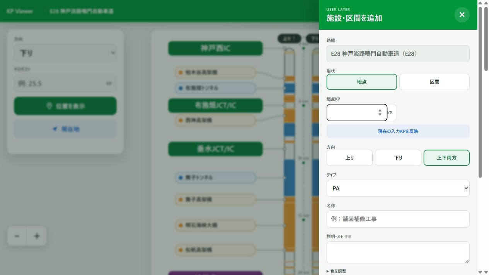
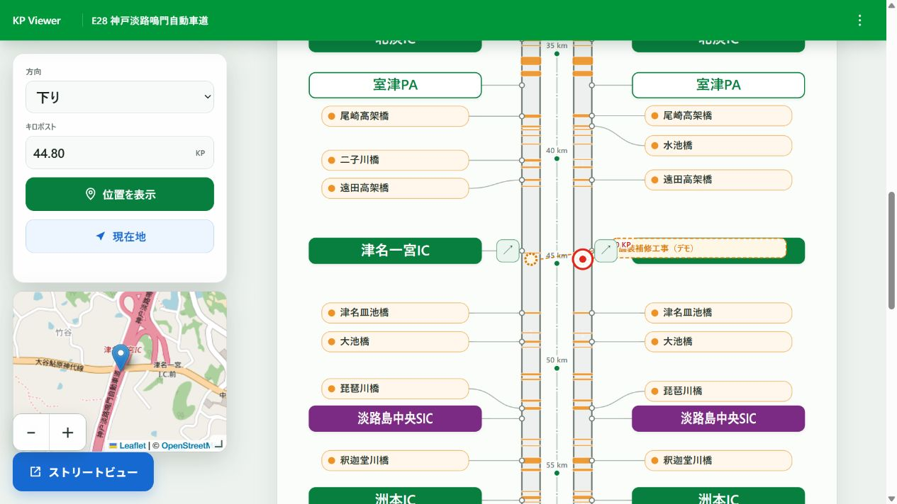
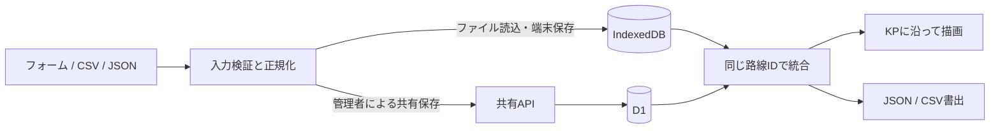
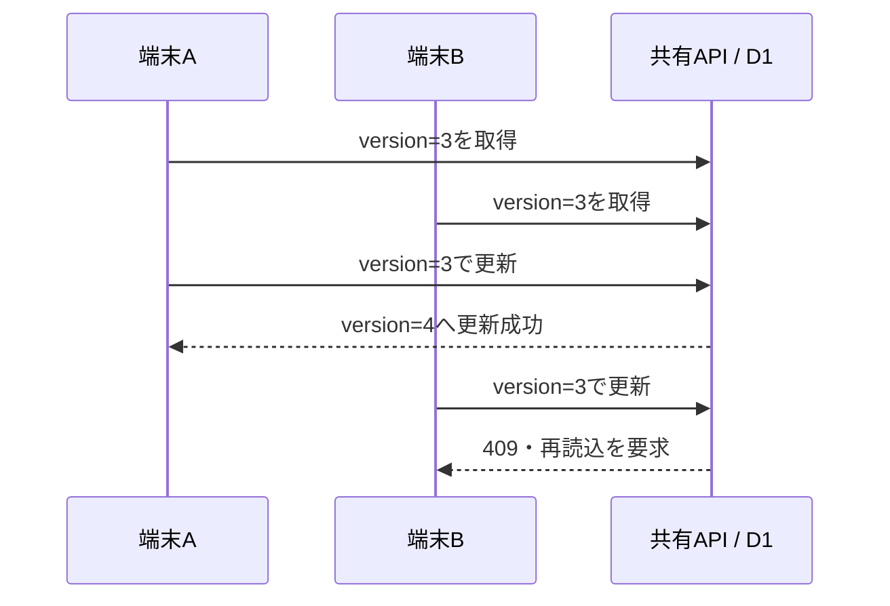

# 編集モード：追加データの登録・保存・ファイル入出力

更新日：2026年11月6日。公開アプリ `2026.11.6-beta.7` の実装を基準とします。

編集モードでは、工事・事故・設備・メモなどの地点や区間を路線図へ追加できます。既存のIC・橋梁・トンネルとは別のデータとして保存します。

[E28で編集モードを開く](https://highway-kp-viewer.pages.dev/viewer?route=e28) · [走行モード](drive-mode.md) · [資料一覧](README.md)

## 1. 地点・区間を追加する

1. 路線ページ右上のメニューから「編集モード」を開きます。
2. 地点または区間を選び、KPを入力します。地点では終点KPは不要です。
3. 方向、タイプ、名称を指定します。説明・色は必要に応じて調整します。
4. 表示期限と保存先を確認し、「追加する」を押します。
5. 「追加しました」の通知を確認します。次の入力に向けて名称・説明・KPは空になり、タイプ・方向・色などは維持されます。

「現在の入力KPを反映」は、通常ビューの入力KP・方向・KP体系を編集フォームへ反映します。KPの小数桁に刻み制限はありません。入力値はJavaScriptの数値として保持します。



画像はパネル構成の参考です。現行版は「追加する／変更を保存」のボタンと、以下に説明するファイル操作欄を備えています。

### 入力項目

| 項目 | 内容 |
| --- | --- |
| 路線 | 開いている路線に固定 |
| 路線名・KP体系 | 複数体系がある場合に選択 |
| 地点／区間 | 地点は起点KPのみ、区間は起点・終点KP |
| 方向 | 上りのみ・下りのみ・両方。路線固有の方向名を表示 |
| タイプ | 事象・事故、工事・規制、TC、ITS、CCTV、電気室、BS、トンネル、橋梁、IC・SIC、JCT、SA、PA、その他 |
| 名称／説明 | 名称60文字以内、説明240文字以内 |
| 色 | タイプ別の初期色と、任意の基本色・サブカラー |
| 表示期限 | 無期限（初期値）、1日、3日、7日、30日 |
| 表示範囲 | この端末のみ／共有・全員に表示 |

## 2. 保存先を選ぶ

| 項目 | この端末のみ | 共有・全員に表示 |
| --- | --- | --- |
| 保存先 | ブラウザのIndexedDB | サーバー側のCloudflare D1 |
| 登録・編集・削除 | 管理者キー不要 | 管理者キーが必要 |
| 閲覧 | 同一サイト・同一ブラウザ | 同じ路線を閲覧する利用者 |
| 別端末への移動 | ファイルを書き出し、別端末で読み込む | サイトから取得 |
| ファイル読込先 | 常にこちら | ファイル読込だけでは共有投稿しない |

端末保存はPC再起動で直ちに消える仕組みではありません。ただし、ブラウザのサイトデータ削除、プライベートブラウズ、別ブラウザ・別端末への変更では引き継がれません。保存の継続を保証するバックアップではないため、必要なデータはファイルへ書き出してください。

全国版・本四版・管理事務所版など入口が違っても、同一サイト上の同じ路線IDを参照します。描画時は表示範囲外の項目を除外・範囲調整します。保存データそのものを管理事務所ごとに複製する構成ではありません。

管理者キーは共有の書き込み操作時にダイアログで入力します。現在の編集セッション中は再利用し、編集パネルを閉じるとメモリ上の保持を解除します。エクスポートファイルには含みません。追加者名の入力欄はありません。

## 3. 追加済みデータを編集する

追加済み一覧は、上下線・保存先を混在させて起点KPの数値昇順に並びます。複数のKP体系がある場合も、現在は各レコードの `startKp` をそのまま比較します。

| 操作 | 動作 |
| --- | --- |
| 「編集」 | フォームへ読み込み、「編集中：名称」を表示 |
| 「変更を保存」 | 対象レコードを更新。共有項目はバージョンを照合 |
| 「編集をやめる」 | 保存せず新規入力へ戻る |
| 「削除」 | 対象1件を削除。共有項目では管理者キーが必要 |

追加ラベルを選ぶと、既存施設と同様に該当KPへ移動します。種別ごとの非表示は路線ページのメニューで切り替えられます。



## 4. ファイルを読み込む

追加済み一覧の上にある「ファイル読込」から、UTF-8の `.json` または `.csv` を選びます。事前にCSVをJSONへ変換する必要はありません。

読込は以下のルールで処理します。

- 1回の上限は入力レコード500件です。
- 読込先は常に「この端末のみ」です。ファイル内の公開指定では共有投稿できません。
- `routeId` が現在の路線と違うレコードはスキップします。省略時は現在の路線になります。
- `id` が一致する端末レコードは更新し、それ以外は追加します。`id` がなければ新規発行します。
- 既存の別IDデータを一括置換する操作ではありません。
- 同じIDを残して再読込すれば更新できます。IDを削除して繰り返し読むと重複が増えます。
- 形式・値の検証が通ってからIndexedDBへまとめて保存します。

共有項目と同じIDを端末へ読み込むと、その端末ではローカルの内容が優先されます。共有データ自体を書き換えることはありません。

### JSON形式

レコードの配列、または `records` 配列を持つオブジェクトを受け付けます。以下は説明用の架空データです。

```json
{
  "schemaVersion": 1,
  "records": [
    {
      "id": "sample-cctv-1",
      "routeId": "e28",
      "kpSystemId": "route",
      "geometryType": "point",
      "startKp": 25.4321,
      "endKp": null,
      "direction": "down",
      "type": "cctv",
      "name": "CCTV設備（説明用）",
      "description": "現地確認用メモ",
      "colors": { "primary": "#c0266d", "secondary": "#fff0f6" },
      "visibility": "private",
      "expiresAt": null
    }
  ]
}
```

### CSV形式

編集モードへ直接読み込む場合の必須列は `name,startKp` です。列名は英字の大文字・小文字を区別します。区間には `geometryType=section` と、起点より大きい `endKp` が必要です。

```csv
id,routeId,kpSystemId,geometryType,startKp,endKp,direction,type,name,description,primary,secondary,createdAt,expiresAt
sample-cctv-1,e28,route,point,25.4321,,down,cctv,CCTV設備（説明用）,現地確認用メモ,#c0266d,#fff0f6,,
sample-work-1,e28,route,section,30.25,30.75,both,construction,工事区間（説明用）,舗装補修,,,,
```

| 列 | 内容・省略時の扱い |
| --- | --- |
| `id` | 同一項目の更新用識別子。省略時は新規発行 |
| `routeId` | 路線ID。省略時は現在の路線 |
| `kpSystemId` | KP体系ID。省略時は `route`。複合路線では正しいIDを指定 |
| `geometryType` | `point` または `section`。省略時は地点 |
| `startKp` | 必須。0～2,000の有限数 |
| `endKp` | 区間では必須。`startKp < endKp <= 2000` |
| `direction` | `up`、`down`、`both`。省略時は両方向 |
| `type` | 下記の種別ID。不明な値は `other` |
| `name` | 必須。60文字以内 |
| `description` | 任意の説明。読込時は240文字まで |
| `primary` / `secondary` | `#rrggbb` 形式。未指定・不正な色はタイプ別初期色 |
| `createdAt` | 登録日時。未指定・不正な日時は読込時刻 |
| `expiresAt` | 期限の日時。未指定・不正な日時は無期限 |

種別IDは `incident`、`construction`、`tc`、`its`、`cctv`、`electrical`、`bus-stop`、`tunnel`、`bridge`、`ic`、`jct`、`sa`、`pa`、`other` です。タイプは読込時に小文字化しますが、方向・形状は表記どおり指定してください。

カンマ、改行、引用符を含む値はCSVの引用符で囲みます。値中の `"` は `""` とします。UTF-8のBOM、CRLF・LF改行に対応します。Excel等からはUTF-8のCSVとして保存してください。Shift_JISの自動判定は行いません。

既存の[CSV→JSON変換ツール](https://highway-kp-viewer.pages.dev/tools/annotation-converter/)も利用できます。この独立ツールでは `routeId` が必須です。編集モードへの直接CSV読込とは、この必須条件が異なります。

## 5. ファイルを書き出す

形式を選び「書き出し」を押すと、現在の路線の追加データをダウンロードします。種別フィルターで非表示の項目も含みます。同じIDの共有・端末データがある場合は、画面で優先される端末データを出力します。

| 形式 | 向いている用途 | 出力 |
| --- | --- | --- |
| JSON（初期選択） | 属性を確認しながら保存する、再読込する | `schemaVersion` と `records` を持つオブジェクト |
| CSV | 表計算ソフトで編集する、一括入力のひな形にする | 上記14列。UTF-8 BOM付き、CRLF改行 |

ファイル名は `<路線ID>-annotations.json` または `<路線ID>-annotations.csv` です。書出時はKPを表示桁へ丸めません。

JSONの出力にはレコードが持つ属性を含めますが、読込時には公開範囲・追加者・更新バージョン等を再構成します。CSVも読込先は端末内です。**どちらも共有DBの権限・更新履歴をそのまま復元するバックアップではありません。**

## 6. 全削除

ファイル操作欄の左側に「全削除」を配置しています。

1. 現在の路線の端末データ・共有データの件数を確認します。
2. 削除確認ダイアログで実行を選びます。
3. 共有データが含まれる場合は管理者キーを入力します。

対象は読み込み済みの現在の路線の追加データです。既存のIC・橋梁・トンネル等の基礎データには作用しません。共有項目の削除は他の利用者にも反映されます。

削除は1件ずつ行います。途中で失敗すると停止し、完了した削除は取り消しません。必要なデータは実行前に書き出してください。既に期限切れで一覧に読み込まれていない項目や他路線の項目を、サーバーから物理的に一掃する操作ではありません。

## 7. データとAPIの構成



端末DB名は `kp-viewer-user-layer`、ストア名は `items`、路線検索用インデックスは `routeId` です。期限切れ項目は読込時に除外します。編集一覧のソートは次の数値比較で行います。

```js
records = [...merged.values()].sort((a, b) => Number(a.startKp) - Number(b.startKp));
```

### 共有API

| メソッドとパス | 処理 |
| --- | --- |
| `GET /api/annotations?route=e28` | 有効期限内の一覧取得 |
| `POST /api/annotations` | 管理者による追加・マージ |
| `PUT /api/annotations/:id` | バージョンを指定した更新 |
| `DELETE /api/annotations/:id?route=e28` | 1件削除 |

書き込みには `Authorization: Bearer …` または `X-Admin-Key` を使用し、サーバーのシークレット `ANNOTATIONS_ADMIN_KEY` と照合します。実際のキーをソース、JSON、CSV、説明資料へ含めません。

### 共有編集の競合検出

`PUT` は読み込んだ `version` が現在のDBと一致した場合だけ更新します。古い版からの更新はHTTP 409です。再読込後に内容を確認し、更新し直します。



中核の条件は次のとおりです。削除や `POST` のマージまで、この楽観ロックで保護する仕様ではありません。

```sql
UPDATE annotations
SET payload = ?, version = version + 1, updated_at = ?, expires_at = ?
WHERE route_id = ? AND id = ? AND version = ?
```

## 8. 運用設定と実装ファイル

共有保存にはD1バインディング `ANNOTATIONS_DB`、テーブル定義 `migrations/0001_annotations.sql`、シークレット `ANNOTATIONS_ADMIN_KEY` が必要です。D1が利用できない環境でも、端末内の機能は独立して利用できます。

| ファイル | 役割 |
| --- | --- |
| `js/editorPreview.js` | 入力・一覧・IndexedDB・共有API・描画用データ |
| `js/annotationFiles.js` | CSVの読込と書出 |
| `css/editor-preview.css` | 編集パネルの基本表示 |
| `css/editor-json-import.css` | ファイル操作・編集状態・保存通知 |
| `css/editor-item-actions.css` | 既存レコードの操作 |
| `server/annotation-service.js` | 共有データの検証・認証・DB操作 |
| `functions/api/annotations.js`、`functions/api/annotations/[id].js` | API入口 |

共有情報は閲覧者へ配信されます。アクセス制限を前提とする社内情報などを登録するための仕組みではありません。今後の改善候補は、取込前プレビュー、差分確認、選択範囲だけの書出、部分削除の操作です。現時点では未実装です。
